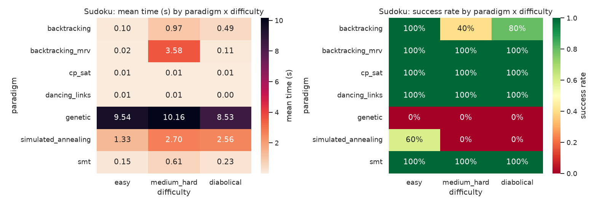
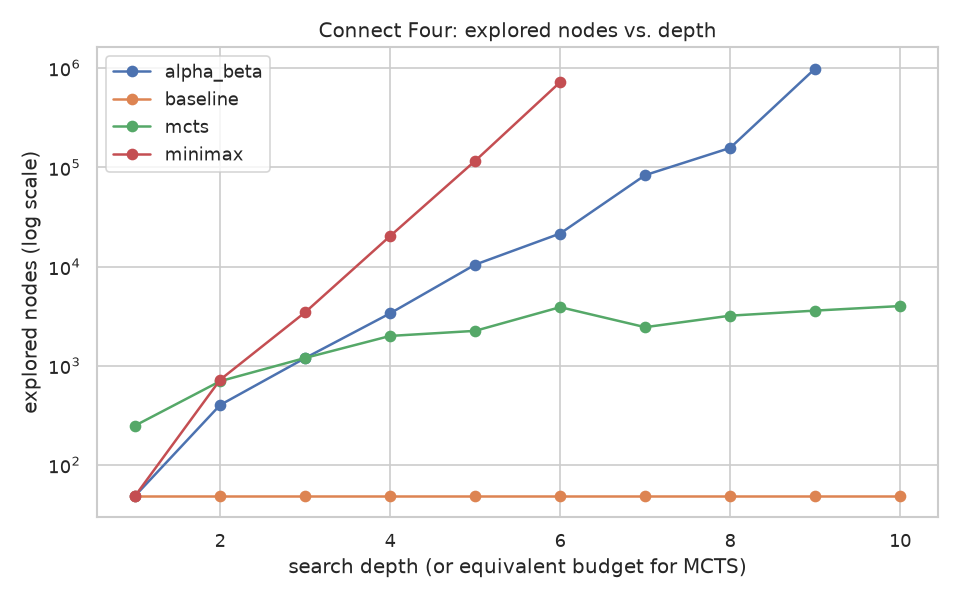
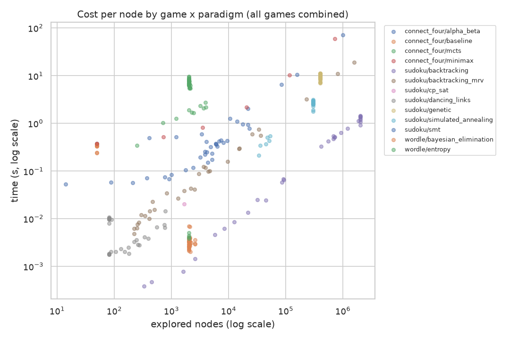

# Cross-paradigm solver benchmark

A reproducible evaluation harness comparing **13 solvers from different paradigms** (exact search, constraint programming, SAT/SMT, metaheuristics, adversarial search, information theory) on **3 games**, under one shared measurement framework: wall time, memory, explored nodes and success rate, with frozen instances and every failure recorded rather than hidden.

What this repository demonstrates:

- **A common measurement protocol** across very different algorithms: one `Metrics` schema, per-instance timeout counted as failure, parallel execution, a CSV checkpoint after each solver.
- **Reproducibility**: seeded instance sampling, committed datasets and precomputed results, a test suite (`uv run pytest`).
- **Analysis of failures, not only successes**: see [Failure analysis](#failure-analysis) and [Threats to validity](#threats-to-validity).

| Game | Solvers (paradigm) |
|---|---|
| **Sudoku** (constraint satisfaction) | Backtracking + MRV, Dancing Links (Algorithm X), genetic algorithm, simulated annealing, CP-SAT (OR-Tools), SMT (Z3) |
| **Connect Four** (adversarial search) | Minimax, alpha-beta pruning, MCTS (UCB1), greedy baseline |
| **Wordle** (sequential decision, partial feedback) | Bayesian elimination, entropy maximisation, CSP (CP-SAT) |

The goal is not to crown a "best" solver but to show which paradigm fits which class of problem, with measurements. (A plain backtracking variant without MRV is also run as a Sudoku reference point, giving 14 evaluated configurations.)







## Key results

All numbers below come from the committed [`results/*.csv`](results/) (analysis and discussion in [`notebook.ipynb`](notebook.ipynb)).

**Sudoku** (30 grids: 10 each from Easy51, top95, hardest11; 210 runs)

| Solver | Solved | Mean time (s) | Mean nodes | Median nodes |
|---|---|---|---|---|
| Backtracking (naive) | 22/30 | 0.522 | 804,025 | 614,729 |
| Backtracking + MRV | 30/30 | 1.236 | 91,682 | 2,344 |
| Dancing Links | 30/30 | 0.006 | 217 | 96 |
| CP-SAT | 30/30 | 0.010 | 55 | 0 |
| SMT (Z3) | 30/30 | 0.328 | 5,937 | 4,558 |
| Simulated annealing | 6/30 | 2.198 | 248,836 | 300,001 |
| Genetic algorithm | 0/30 | 9.410 | 400,200 | 400,200 |

- Dancing Links, CP-SAT, SMT and backtracking+MRV solve every grid, including the hardest ones. CP-SAT needs no branching at all on most grids (median 0 nodes, the mean is pulled up by a few hard instances, max 1,664).
- Naive backtracking fails 8/30 grids (all on top95 / hardest11) by exhausting its 2,000,000-node budget. MRV cuts mean nodes by ~9x, but each node is costlier (it recomputes the candidates of every empty cell), so it is slower in wall-clock time than naive backtracking on top95 (mean 3.6 s vs 1.0 s): fewer nodes does not mean less time.
- The (simple) metaheuristics are not competitive: the GA never solves a grid, simulated annealing solves only 6 of the 10 easy ones.

**Connect Four** (each agent plays one full game as first player against a fixed alpha-beta depth-4 reference; 35 games)

- Minimax wins at depths 3-6 and alpha-beta at depths 3-8; neither wins at depths 1-2.
- At depth 6, minimax visits 721,599 nodes versus 21,531 for alpha-beta (~33x fewer), which is why minimax is only run up to depth 6 and alpha-beta up to depth 9.
- The greedy baseline (0/10) and MCTS with 50-500 simulations (0/10) never beat the reference.
- Alpha-beta at depth 9 *loses* to the depth-4 reference in the committed run. This is a heuristic artefact, not a bug: the game is deterministic and the loss reproduces exactly, but the same agent wins 5 of 6 extra games (vs depth-3/4/5 references, both sides; [`scripts/diagnose_alpha_beta_depth9.py`](scripts/diagnose_alpha_beta_depth9.py)), and depths 7, 8 and 10 all beat the depth-4 reference. With a purely heuristic evaluation, playing strength is not strictly monotonic in depth, and one game per depth is a single trajectory.

**Wordle** (40 target words, 10 for each length 5-8; 120 runs)

| Solver | Solved (<= 6 tries) | Mean attempts | Mean time per game (s) |
|---|---|---|---|
| Entropy maximisation | 40/40 | 2.73 | 6.49 |
| Bayesian elimination (random compatible word) | 40/40 | 3.30 | 0.003 |
| CSP (CP-SAT, any compatible word) | 40/40 | 3.40 | 0.111 |

Entropy needs ~0.6 fewer guesses than picking a random compatible word, at ~2000x the compute per game.

## Failure analysis

Every failed run is kept in the CSVs. Here is why they failed, computed from [`results/*.csv`](results/). No run hit the 120 s timeout:

| Game | Solver | Failures | Failure mode | Evidence |
|---|---|---|---|---|
| Sudoku | Backtracking (naive) | 8/30 | Search budget exhausted | 6 on top95, 2 on hardest11, none on easy; all stopped at the 2,000,000-node cap after ~1 s |
| Sudoku | Genetic algorithm | 30/30 | Does not converge | Always stops at 400,200 evaluations with 2 to 10 residual conflicts (median 5.5 to 6.5), on every difficulty including easy |
| Sudoku | Simulated annealing | 24/30 | Stuck in a local minimum | 4 easy, 10 top95, 10 hardest11; stops at 300,001 evaluations, median residual cost 2 |
| Connect Four | Minimax, alpha-beta (depth 1-2) | 4/4 | Search horizon too short | Loses to the depth-4 reference in 14 to 36 plies |
| Connect Four | Alpha-beta (depth 9) | 1/1 | Heuristic artefact | Loses once, reproducibly; 5 of 6 diagnostic games are won (see above) |
| Connect Four | Greedy baseline | 10/10 | Loses every game | Always beaten in 14 plies |
| Connect Four | MCTS (50-500 simulations) | 10/10 | Loses every game | Beaten in 10 to 26 plies; larger simulation budgets were not tested |
| Wordle | all three | 0/120 | none | every target found within 6 tries |

Reading: the exact solvers never fail on Sudoku, the failures are all *resource exhaustion* (budget, evaluations) or *weak evaluation* (Connect Four), never a wrong answer or a timeout.

## Threats to validity

These results are measurements, not proofs. What limits them:

- **Small samples.** 30 Sudoku grids (10 per difficulty), 40 Wordle targets, one game per Connect Four depth. With 30 grids, a 30/30 score is compatible with a true success rate as low as 89% (Wilson 95% interval: 88.6-100%); 22/30 is compatible with 56-86%, and 6/30 with 10-37%. Rankings between solvers that are far apart are solid; small differences are not.
- **One run per instance.** Stochastic solvers (genetic, annealing, MCTS) use a single fixed seed (0); their failure rates are not averaged over seeds.
- **A single Connect Four opponent.** "Win" means beating a depth-4 alpha-beta with one heuristic, as first player only, from the empty board; the game is deterministic, so one game per depth is one trajectory.
- **Timing under contention.** Instances run in parallel (CPU count - 1 workers), so wall-clock times are relative, not absolute. Node counts are comparable within a solver family, not across families.
- **Memory is not a per-solve measurement.** `peak_memory_mb` is `ru_maxrss` of a pooled worker process, i.e. a running maximum that includes the interpreter and the imported libraries. It only separates solvers with heavy native libraries (CP-SAT, Z3 at ~70-95 MB versus ~47-58 MB for the others); it says nothing about the algorithmic memory cost.
- **The timeout is not enforced for native solvers.** `SIGALRM` is handled between Python bytecodes, so a long CP-SAT or Z3 call is not interrupted until it returns, and those solvers have no internal time limit. In the committed results none of them came close to 120 s.
- **One machine, one word list.** Wordle targets come from a single list (`web2`); no repeated runs on other hardware.
- **Unix only.** The timeout relies on `SIGALRM`.

Not done: repeated runs with several seeds and confidence intervals on timings, larger MCTS budgets, more opponents for Connect Four.

## Methodology

- **Common metrics** ([`benchmark/core.py`](benchmark/core.py)): every run produces one `Metrics` row (game, paradigm, instance, difficulty, success, wall time, peak memory, nodes explored, solution quality). A "node" is defined per family (assignment tried, game-tree node, fitness evaluation, candidate word), so node counts are comparable within a family, not across families.
- **Frozen instances**: Sudoku grids and Wordle words are sampled with a fixed seed (42) from files committed in [`data/`](data/); Connect Four instances are generated in code (empty board + depth parameter); stochastic solvers use a fixed seed (0).
- **Per-instance timeout**: each instance is limited to 120 s (SIGALRM); on timeout it is recorded as a failure and the benchmark moves on. This does not apply to native CP-SAT/Z3 calls (see [Threats to validity](#threats-to-validity)). No instance hit the timeout in the committed results (the slowest run took ~72 s).
- **Parallel execution**: instances of a solver are independent and run in a `ProcessPoolExecutor` (CPU count - 1 workers). Consequently wall-clock times are measured under some CPU contention and should be read as relative, not absolute.
- **Checkpointing**: the results CSV of each game is rewritten after every solver finishes ([`benchmark/run_all.py`](benchmark/run_all.py)), so an interrupted run loses at most one solver.
- **Memory**: `ru_maxrss` of the worker process (cheap, no tracing overhead). Workers are reused, so this is a running maximum, not a per-instance peak (see [Threats to validity](#threats-to-validity)).
- **Results schema** (`results/<game>_results.csv`): `game, paradigm, instance_id, difficulty, success, time_seconds, peak_memory_mb, nodes_explored, solution_quality`, plus game-specific `extra_*` columns (`extra_budget_exceeded` for Sudoku, `extra_winner` for Connect Four, `extra_timed_out` if a run is interrupted). Rows are written in instance order, so repeated runs give the same row order.
- Unix only (uses `resource` and `SIGALRM`). Python >= 3.13.

## Quick start

```bash
uv sync                            # installs runtime, dev and notebook dependencies
uv run pytest                      # unit tests
uv run ruff check .                # lint
uv run python -m benchmark.run_all # regenerate results/*.csv (several minutes)
uv run jupyter lab                 # open notebook.ipynb (loads the precomputed CSVs)
```

## Layout

```
benchmark/            solver implementations + shared framework
  core.py             Metrics, NodeCounter, timeout, sequential/parallel runners
  sudoku/ connect_four/ wordle/
  run_all.py          runs every benchmark, writes results/*.csv
data/                 frozen instances (Sudoku grids, Wordle word lists)
results/              precomputed CSVs and figures
scripts/              one-off diagnostics (alpha-beta depth-9 check)
tests/                pytest suite (framework, solvers, games)
notebook.ipynb        theory, analysis, paradigm-selection guide
```

## Data and licences

- **Sudoku grids** (`data/sudoku/`): Easy51 / top95 / hardest11 collections, 81-character format.
- **Wordle word lists** (`data/wordle/`, 2,000 words per length, 5-8 letters): sampled from the `web2` list (Webster's Second International, as distributed with FreeBSD) of the [`english-words`](https://pypi.org/project/english-words/) Python package (MIT-licensed code) and frozen as text files. Every word of the files is in `web2`; the package's other bundled list (GNU GCIDE, GPL) was not used.
- **Code**: [MIT](LICENSE).

## Context

Built as a solo project for the *Intelligence Symbolique* course at EPITA (SCIA), subject L4, "cross-paradigm benchmark of game solvers".
Developed in July 2026; code, tests and documentation were cleaned up, translated to English and extended in October 2026.
